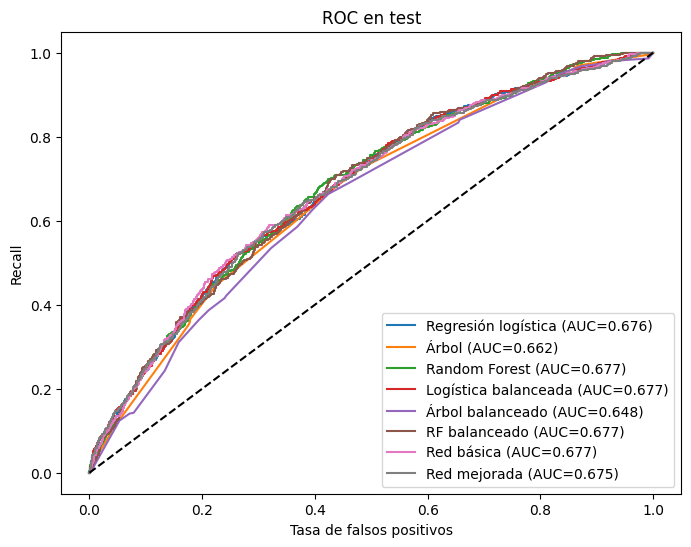
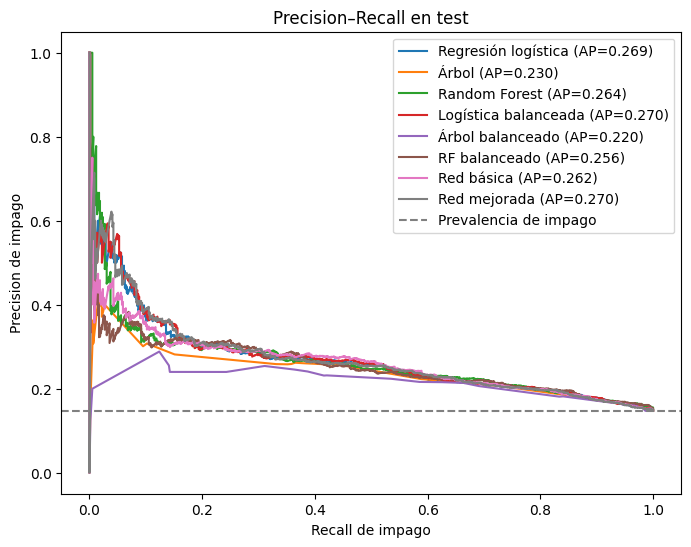
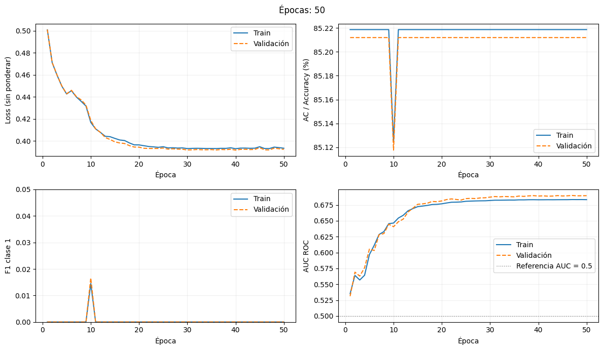
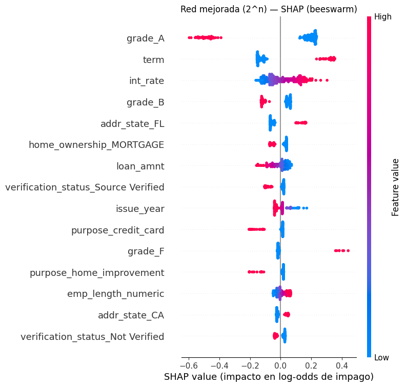

# Predicción de impago en préstamos de Lending Club con redes neuronales

Tarea Académica 1 del curso **Deep Learning para Finanzas (1FIN58)**, Pontificia Universidad Católica del Perú.

En este proyecto se entrenan redes neuronales densas (Keras/TensorFlow) para predecir si un préstamo termina en impago (`Charged Off`) o se paga (`Fully Paid`). Las redes se comparan con regresión logística, árbol de decisión y *Random Forest*, y se interpretan con coeficientes, importancias y SHAP.

> **Resultado principal:** la búsqueda secuencial de hiperparámetros produjo una red estable, sin sobreajuste (AUC de 0.683 / 0.690 / 0.675 en entrenamiento / validación / prueba), pero **no superó a los modelos base**: en prueba, todos los modelos competitivos quedan en un AUC de 0.675–0.677 y un F1 de 0.33–0.34. Que modelos tan distintos converjan al mismo valor indica que el límite está en la información de las variables, no en el modelo.

---

## Contenido del repositorio

```
.
├── README.md
├── requirements.txt
├── .gitignore
├── data/
│   ├── dataset.xlsx                 # 19 908 préstamos de Lending Club
│   └── README.md
├── notebooks/
│   ├── 00_avance_inicial.ipynb                       # Avance original (con los errores diagnosticados)
│   └── 01_red_neuronal_busqueda_secuencial.ipynb     # Notebook final, ejecutado
├── informe/
│   ├── Informe_final_Tarea1.pdf     # Informe final compilado (25 páginas)
│   ├── informe_final.tex            # Código LaTeX
│   └── figuras/
├── guia_repaso/
│   ├── Guia_repaso_metricas_hiperparametros.pdf   # Guía teórica con ejemplos (23 páginas)
│   ├── guia_repaso.tex
│   ├── generar_figuras.py           # Genera las figuras ilustrativas de la guía
│   └── figuras/
└── docs/img/                        # Figuras usadas en este README
```

| Documento | Para qué sirve |
|---|---|
| [`notebooks/01_red_neuronal_busqueda_secuencial.ipynb`](notebooks/01_red_neuronal_busqueda_secuencial.ipynb) | Todo el flujo: preprocesamiento, búsqueda de hiperparámetros, modelos base, métricas, gráficos y SHAP. |
| [`informe/Informe_final_Tarea1.pdf`](informe/Informe_final_Tarea1.pdf) | Informe con la metodología, los resultados etapa por etapa, la comparación con los modelos base, la interpretabilidad, la discusión y las conclusiones. |
| [`guia_repaso/Guia_repaso_metricas_hiperparametros.pdf`](guia_repaso/Guia_repaso_metricas_hiperparametros.pdf) | Repaso teórico de cada métrica y cada hiperparámetro usados, con ejemplos resueltos y preguntas de repaso. |

---

## Datos

- **Fuente:** base de préstamos de Lending Club entregada en el curso (`data/dataset.xlsx`).
- **Objetivo:** `loan_status` → `Fully Paid` = 0, `Charged Off` = 1.
- **Desbalance:** 14.8 % de impagos. Un modelo que siempre dice «pagado» obtiene 85.2 % de exactitud con F1 = 0.
- **Partición estratificada:** 64 % entrenamiento (12 739), 16 % validación (3 185), 20 % prueba (3 981).
- **Preprocesamiento:** se ajusta solo con entrenamiento. Imputación por mediana y moda, MinMaxScaler en las variables numéricas y *one-hot* en las categóricas. Resultan 49 variables.

## Metodología

1. **Corrección del avance inicial.**
   - El MinMaxScaler no llegaba a los modelos.
   - La imputación usaba toda la base (fuga de información).
   - Las etiquetas vacías se convertían en `Fully Paid`.
   - Por el desbalance, las redes predecían siempre la clase 0.
2. **Política de umbral.** Se reportan el umbral fijo de 0.5 y un umbral que maximiza el F1 en validación, congelado antes de evaluar en prueba.
3. **Búsqueda secuencial de hiperparámetros.** Se varía un hiperparámetro por etapa y se elige por AP de validación. Son 43 entrenamientos (unos 73 minutos en Colab), en este orden:

   `balanceo → optimizador → learning rate → batch → activación → capas → neuronas → distribución de neuronas → dropout → regularización L1/L2 → early stopping → épocas`

4. **Modelos base.** Regresión logística, árbol de decisión y *Random Forest*, cada uno con y sin `class_weight='balanced'`.
5. **Interpretabilidad.** Coeficientes logísticos, importancias por impureza y SHAP (`KernelExplainer`) sobre la red final.

## Resultados

**Red final:** 20 capas × 64 neuronas `tanh`, Adam (lr = 0.0001), batch 32, dropout 0.25, L1 = 1e-4, 50 épocas (82 305 parámetros).

Resultados en **prueba**, con el umbral elegido en validación:

| Modelo | AUC | Gini | AP | F1 | Exactitud (%) |
|---|---|---|---|---|---|
| Regresión logística | 0.676 | 0.352 | 0.269 | 0.335 | 72.70 |
| **Logística balanceada** (seleccionada en validación) | **0.677** | 0.354 | **0.270** | 0.339 | 72.75 |
| Random Forest | 0.677 | 0.355 | 0.264 | 0.334 | 67.87 |
| Red básica (1 × 100, ReLU) | 0.677 | 0.354 | 0.262 | **0.341** | 67.19 |
| Red mejorada (20 × 64, tanh) | 0.675 | 0.349 | 0.270 | 0.337 | 70.79 |

<p align="center">
  
  
</p>

<p align="center">
  
</p>

### Hallazgos

- **Desbalance:** los pesos de clase y el ajuste del umbral producen casi el mismo efecto (F1 ≈ 0.36 en validación); los pesos no mejoran el AP.
- **Profundidad:** el mejor AP de toda la búsqueda (0.2765) lo dio una red de **una sola capa** con `tanh`. Con 100 capas, la red colapsó por desvanecimiento del gradiente (AUC 0.57).
- **Orden de la búsqueda:** reordenar las etapas eliminó el sobreajuste de una corrida anterior, que había llegado a un AUC de 0.996 en entrenamiento frente a 0.582 en prueba.
- **Interpretabilidad:** coeficientes, importancias y SHAP coinciden en que la **tasa de interés**, el **plazo**, el **grado crediticio** y el **propósito** son los principales determinantes del riesgo.

<p align="center">
  
</p>

## Cómo ejecutar

### Google Colab (recomendado)

1. Abre `notebooks/01_red_neuronal_busqueda_secuencial.ipynb` en Colab.
2. Sube `data/dataset.xlsx` a tu Drive y ajusta la ruta en la celda de carga (`candidatos = [...]`), o súbelo directamente al entorno de Colab.
3. Ejecuta todas las celdas en orden. Con `MODO_RAPIDO = False` la búsqueda tarda unos 75 minutos; con `MODO_RAPIDO = True` corre una versión reducida.

### Local

```bash
git clone <url-del-repositorio>
cd lending-club-impago-deep-learning
python -m venv .venv && source .venv/bin/activate   # en Windows: .venv\Scripts\activate
pip install -r requirements.txt
cp data/dataset.xlsx notebooks/
jupyter notebook notebooks/01_red_neuronal_busqueda_secuencial.ipynb
```

> Fuera de Colab, omite la celda `from google.colab import drive` (dará error) y deja `dataset.xlsx` junto al notebook.

### Compilar los documentos LaTeX

Ambos documentos compilan con `pdflatex` (dos pasadas) y solo usan paquetes estándar de TeX Live / Overleaf:

```bash
cd informe && pdflatex informe_final.tex && pdflatex informe_final.tex
cd ../guia_repaso && pdflatex guia_repaso.tex && pdflatex guia_repaso.tex
```

En Overleaf, sube el `.tex` junto con su carpeta `figuras/`. Las figuras ilustrativas de la guía se regeneran con `python generar_figuras.py` desde `guia_repaso/`.

## Limitaciones

- Toda la búsqueda usa **una sola semilla** (42). Diferencias de AP de 0.001–0.005 están dentro del ruido esperable.
- Validación se reutiliza en muchas decisiones; por eso la prueba se reserva para la evaluación final.
- En la etapa de *dropout* no se incluyó el valor 0, y el procedimiento eligió 0.25 aunque empeoró el AP.
- SGD se comparó con un learning rate pensado para optimizadores adaptativos (0.001).
- El texto de la sección 11.4 del notebook proviene de una corrida anterior; las cifras vigentes son las de las salidas de las celdas y las del informe.
- La sección 12 del notebook (arquitectura `raimundo`) es un experimento adicional que no forma parte del informe.

## Trabajo futuro

- Ingeniería de variables (cuota/ingreso, monto/ingreso, antigüedad del historial crediticio).
- *Gradient boosting* (XGBoost / LightGBM) como referencia más exigente.
- Redes de 1–2 capas, incluyendo siempre la configuración vigente en cada etapa, con varias semillas o validación cruzada.
- Elección del umbral según el costo real de cada tipo de error.

## Autores

- Sebastián Estefano Hernández Muñaqui
- *[Integrantes del grupo]*

Curso: Deep Learning para Finanzas (1FIN58), PUCP, 2026.

## Referencias principales

- Kingma, D. P., & Ba, J. (2015). Adam: A method for stochastic optimization. *ICLR*.
- Srivastava, N., et al. (2014). Dropout: A simple way to prevent neural networks from overfitting. *JMLR, 15*, 1929–1958.
- Lundberg, S. M., & Lee, S.-I. (2017). A unified approach to interpreting model predictions. *NeurIPS 30*.
- Saito, T., & Rehmsmeier, M. (2015). The precision-recall plot is more informative than the ROC plot when evaluating binary classifiers on imbalanced datasets. *PLoS ONE, 10*(3).
- Grinsztajn, L., Oyallon, E., & Varoquaux, G. (2022). Why do tree-based models still outperform deep learning on typical tabular data? *NeurIPS 35, Datasets and Benchmarks*.

La lista completa está en el informe y en la guía de repaso.
